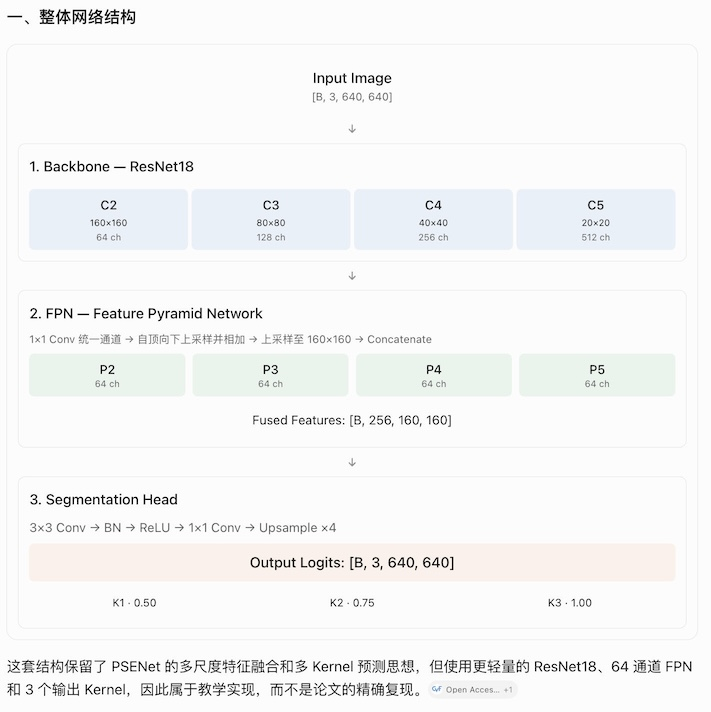

# LearnOCR · Step 3：Minimal PSENet Architecture

这一阶段我们正式用 PyTorch 实现 PSENet 的网络结构：

ResNet18 Backbone + 简化 FPN + 3 通道 Segmentation Head（分割头）。

目标不是一次性实现完整 PSENet，而是先弄清楚：一张图片怎样经过 CNN 提取特征、融合多尺度信息，最终预测 Step 2 中的三个 Kernel。

## 一、整体网络结构


Input Image

[B, 3, 640, 640]

1\. Backbone — ResNet18

C2      160×160     64 ch

C3      80×80       128 ch

C4      40×40       256 ch

C5      20×20       512 ch

2\. FPN — Feature Pyramid Network

1×1 Conv 统一通道 → 自顶向下上采样并相加 → 上采样至 160×160 → Concatenate

P2      64 ch

P3      64 ch

P4      64 ch

P5      64 ch

Fused Features: [B, 256, 160, 160]

3\. Segmentation Head

3×3 Conv → BN → ReLU → 1×1 Conv → Upsample ×4

Output Logits: [B, 3, 640, 640]

K1 · 0.50

K2 · 0.75

K3 · 1.00

这套结构保留了 PSENet 的多尺度特征融合和多 Kernel 预测思想，但使用更轻量的 ResNet18、64 通道 FPN 和 3 个输出 Kernel，因此属于教学实现，而不是论文的精确复现。

[image](https://www.google.com/s2/favicons?domain=https://openaccess.thecvf.com\&sz=32)

Open Access CVF

+1


## 二、最重要的三个模块

### 1. Backbone：为什么选择 ResNet18？

Backbone（骨干网络）负责提取图像特征。

浅层特征通常保留更多位置、边缘和纹理细节；深层特征的空间分辨率较低，但具有更大感受野和更强语义表达能力。

输入 640×640 时：

| 特征层 | 通道数 | 尺寸      | 下采样倍数 |
| --- | --- | ------- | ----- |
| C2  | 64  | 160×160 | 4     |
| C3  | 128 | 80×80   | 8     |
| C4  | 256 | 40×40   | 16    |
| C5  | 512 | 20×20   | 32    |

这些尺寸对应 torchvision ResNet18 中的 `layer1` 到 `layer4` 输出。

[image](https://www.google.com/s2/favicons?domain=https://github.com\&sz=32)

GitHub


为什么不用最后的分类结果？因为我们做的是像素级文本检测，而不是整张图片分类，需要保留二维空间位置信息。

### 2. FPN：为什么要融合四层特征？

考虑两种情况：一张招牌上很大的文字，以及远处很小的文字。

只使用 C2，虽然分辨率高，但语义信息相对不足；只使用 C5，虽然语义信息丰富，但许多小文字的空间细节可能已经丢失。

FPN 的做法是将不同分辨率的特征融合。

例如：

$$
P_5=\operatorname{Conv}\_{1\times1}(C_5)
$$

$$
P_4=\operatorname{Conv}\_{1\times1}(C_4)+\operatorname{Up}(P_5)
$$

然后逐层计算 $P_3$、$P_2$。

这里有两个重要操作：

- Add（逐元素相加）：要求通道数、空间尺寸一致，所以先用 1×1 卷积统一为 64 通道。
- Concat（通道拼接）：把全部 P2–P5 调整到相同空间尺寸后，拼接成 256 通道特征图。

这两种操作的区别你最好亲自看一下代码。

### 3. Head：为什么输出三个通道？

最后的分割头只做两件事：

1. 把 256 通道融合特征转换成 64 通道。
2. 再转换成 3 通道，分别预测 K1、K2、K3。

网络输出的是 Logits（未经 Sigmoid 的原始预测分数）：

```
logits = model(images)              # [B, 3, H, W]probabilities = torch.sigmoid(logits)
```

Sigmoid 将每个像素的预测值转换为 0 到 1 之间的概率值。

这里有一个重要细节：三张预测概率图不一定天然满足 K1 ⊆ K2 ⊆ K3。 Step 2 的监督标签是嵌套的，但模型的三个输出通道没有强制嵌套约束。后续进行 PSE 后处理时，需要考虑这个问题。

## 三、下载并运行 Step 3

我已经生成并测试了完整代码。

LearnOCR — PSENet Step 3

模型实现、测试代码、学习说明

下载 Step 3 代码 ZIP

文件内容

`model.py` — 完整网络模型

`test_model.py` — 前向传播、尺寸和梯度测试

`README_STEP3.md` — 架构说明及运行方法

把 ZIP 解压到现有 `LearnOCR` 仓库根目录，不会覆盖 Step 2 的代码。

目录变为：

```
LearnOCR/
└── text_detection/
    └── psenet/
        ├── kernel.py
        ├── visualize_kernels.py
        ├── model.py          # 新增
        └── test_model.py     # 新增
```

从 `LearnOCR` 根目录执行：

```
python text_detection/psenet/test_model.py
```

再测试正式的 640×640 输入：

```
python text_detection/psenet/test_model.py \
    --height 640 --width 640
```

### 四、实际测试结果

我已用 PyTorch CPU 环境运行，640×640 输入得到以下结果：

```
Input:        (1, 3, 640, 640)

C2:           (1, 64, 160, 160)
C3:           (1, 128, 80, 80)
C4:           (1, 256, 40, 40)
C5:           (1, 512, 20, 20)

fused:        (1, 256, 160, 160)
small_logits: (1, 3, 160, 160)
Logits:       (1, 3, 640, 640)

Backward gradients: PASS
ALL CHECKS PASSED
```

&#x20;基础测试通过

还验证了非标准输入尺寸 191×223，输出仍能够恢复到原始尺寸；梯度可以正常传递到 Backbone、FPN 和 Head。

不过这些都是随机输入的结构测试，不代表模型已经学会了检测文本。

## 五、我希望你亲自理解的三个问题

在进入训练前，你可以用下面三个问题检验学习效果：

1\. 为什么 C2 是 160×160，而不是 640×640？

2\. FPN 为什么先用 1×1 Conv，再进行 Add？

3\. 为什么最后输出三个通道，而不是一个通道？

## 六、下一阶段

Step 4 — PSENet Loss：Dice Loss + Training Mask

这是我们第一次将 Step 2 和 Step 3 连接起来：

$$
\text{Prediction }[B,3,H,W] \quad\longleftrightarrow\quad \text{Ground Truth }[B,3,H,W]
$$

重点实现三个部分：

1. Dice Loss（Dice 损失）的原理与代码。
2. Text Loss 和 Kernel Loss 的计算方式。
3. Training Mask 如何排除 `###` 区域。

最后通过一次前向传播、损失计算和反向传播，验证模型能够根据真实 Kernel 标签更新参数。

这时，PSENet 的核心训练原理就基本串起来了。


